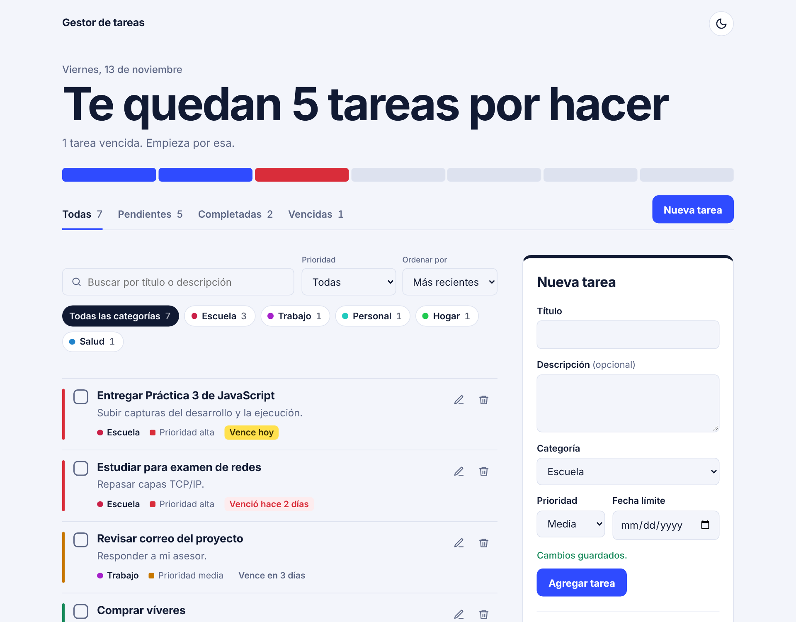
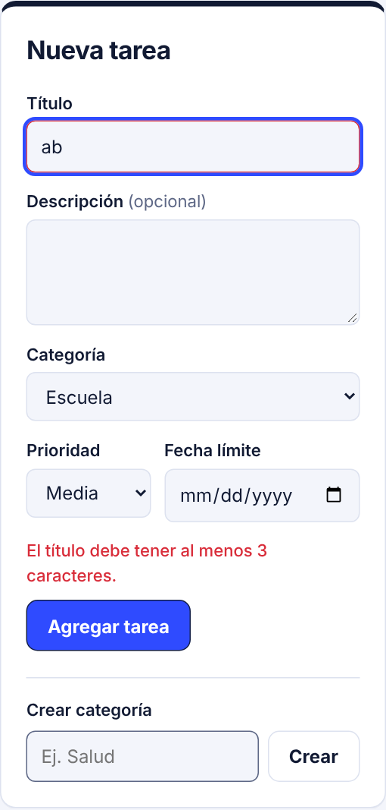
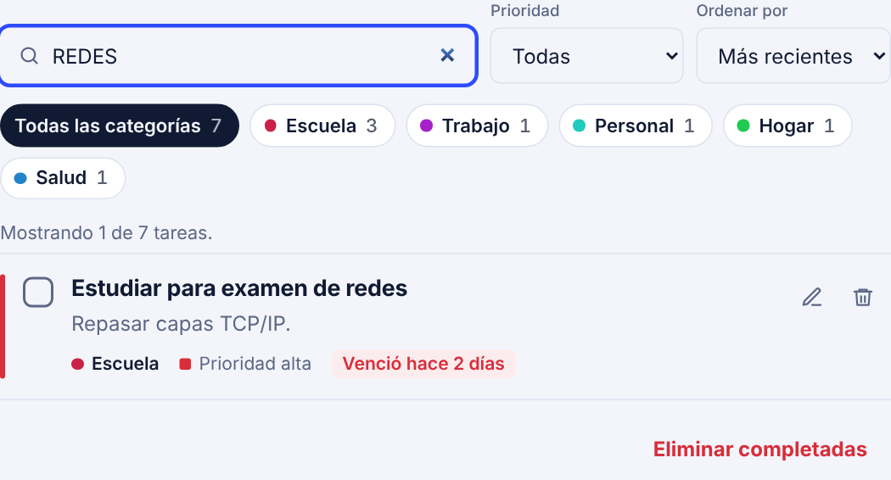
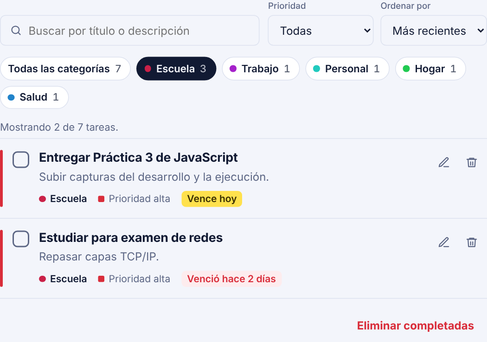
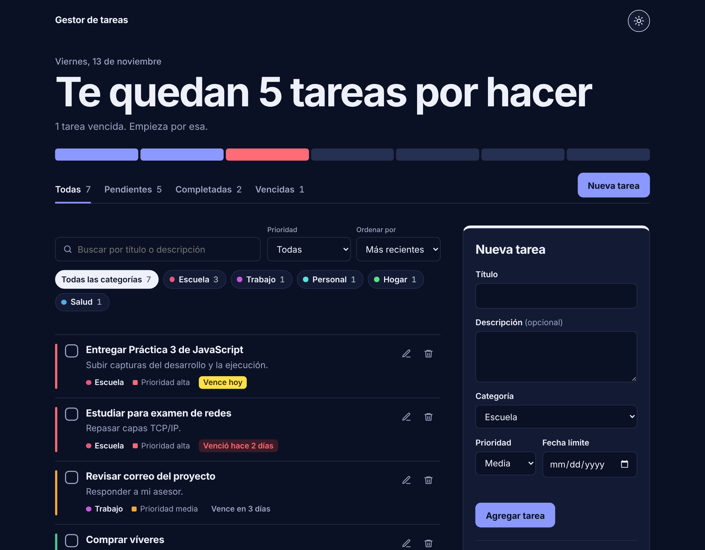
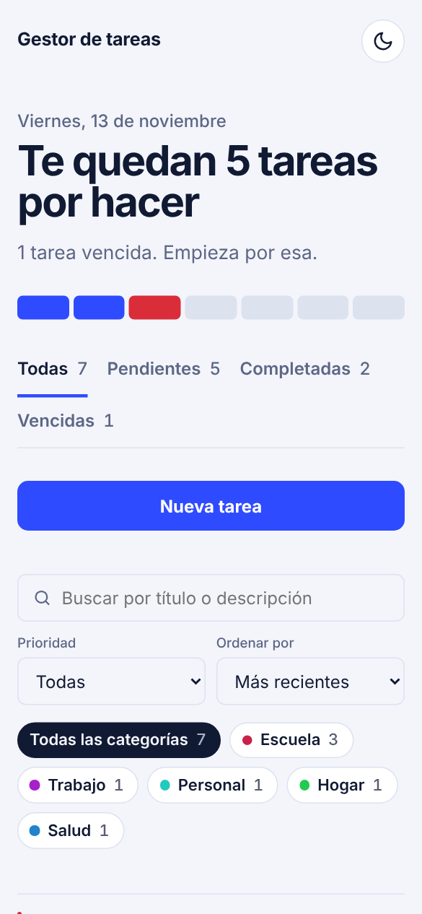
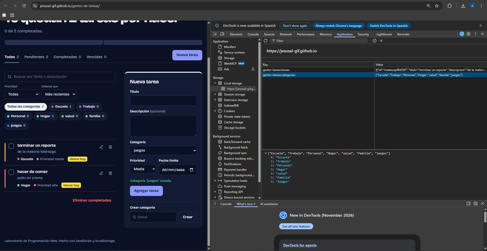

# Gestor de tareas

Aplicación web del lado del cliente para administrar tareas por categoría. No necesita servidor: los datos se guardan en el navegador con `localStorage` y se conservan entre sesiones.

**Actividad 3 – Laboratorio de Programación Web (Unidad 3: JavaScript).**

## Objetivo

Desarrollar una aplicación con JavaScript ES6+, manipulación del DOM, eventos, validación de datos y persistencia local, que permita registrar, visualizar, editar y eliminar información.

## Tecnologías

- HTML5 semántico (`header`, `nav`, `main`, `section`, `aside`, `footer`, formularios con `label`)
- CSS3 con Grid y Flexbox, variables CSS, tema claro y oscuro, diseño responsivo (breakpoints en 900 px y 560 px)
- JavaScript ES6+ sin librerías: `let/const`, arrow functions, template literals, desestructuración, operador spread, `map/filter/some/find`, `try/catch`, `Intl.DateTimeFormat`
- `localStorage` para persistencia (tareas, categorías y tema)

## Funciones

| Requisito | Implementación |
|---|---|
| Modelo de datos | Arreglo de objetos `{ id, titulo, descripcion, categoria, prioridad, fecha, completada, creada }` |
| Agregar / visualizar / editar / eliminar | Formulario, lista dinámica, botones de editar y eliminar, casilla para completar |
| DOM sin recargar | La lista, el encabezado y los filtros se vuelven a pintar con plantillas de texto y delegación de eventos |
| Validación | Título de 3 a 80 caracteres, categoría y prioridad válidas, fecha válida y no pasada (al crear), sin títulos duplicados en la misma categoría; mensajes claros con `aria-live` |
| Persistencia | `localStorage`, con manejo de JSON dañado o almacenamiento bloqueado |
| **Búsqueda** | Por título y descripción, sin distinguir mayúsculas ni acentos |
| **Filtros** | Pestañas por estado (todas, pendientes, completadas, vencidas) con contador, filtro por prioridad y por categoría |
| **Categorías** | Cuatro por defecto (Escuela, Trabajo, Personal, Hogar), creación de categorías propias, color automático por categoría y contador en cada chip |
| Extras | Orden (recientes, fecha límite, prioridad, A-Z), fechas relativas ("Vence hoy", "Venció hace 2 días"), eliminar completadas, tema claro/oscuro |

## Diseño

- **Barra de progreso por segmentos:** cada tarea es una pieza de la barra del encabezado. Azul si está completada, roja si venció y gris si sigue pendiente.
- **Filtros que informan:** las pestañas de estado muestran cuántas tareas hay en cada una, así no hacen falta tarjetas de resumen aparte.
- **Lista en filas:** la barra de color a la izquierda indica la prioridad (también aparece escrita, para no depender solo del color).
- **Accesibilidad:** foco visible, etiquetas en todos los campos, casilla con foco por teclado, mensajes con `aria-live`, contraste legible y `prefers-reduced-motion` respetado.
- **Tipografía:** Bricolage Grotesque (Google Fonts). Si no hay conexión se usa la fuente del sistema.

## Estructura

```
gestor-tareas/
├── index.html
├── styles.css
├── app.js
└── README.md
```

## Cómo ejecutarlo

1. Descarga o clona el repositorio.
2. Abre `index.html` en el navegador (no requiere instalación).

## Publicación en GitHub Pages

1. Sube la carpeta a un repositorio nuevo en GitHub.
2. En **Settings → Pages**, elige la rama `main` y la carpeta raíz (`/`).
3. La liga pública aparecerá en unos minutos.

## Guion para la demostración (3 minutos)

1. **Agregar:** crea 3 tareas con distintas categorías y prioridades; muestra cómo crece la barra de segmentos.
2. **Validar:** intenta guardar un título vacío o una fecha pasada y muestra el mensaje.
3. **Editar y completar:** edita una tarea y márcala como completada.
4. **Buscar y filtrar:** busca una palabra, filtra por categoría, por estado y por prioridad.
5. **Categoría nueva:** crea una categoría y úsala en una tarea.
6. **Tema:** cambia entre modo claro y oscuro.
7. **Persistencia:** recarga la página (F5) y muestra que los datos siguen ahí; abre DevTools → Application → Local Storage para ver las claves.
8. **Eliminar:** borra una tarea y usa "Eliminar completadas".

## Capturas

| Vista principal | Validación |
|---|---|
|  |  |

| Búsqueda | Filtros por categoría y estado |
|---|---|
|  |  |

| Datos conservados tras recargar (localStorage) | Tema oscuro |
|---|---|
|  |  |

Vista móvil:




